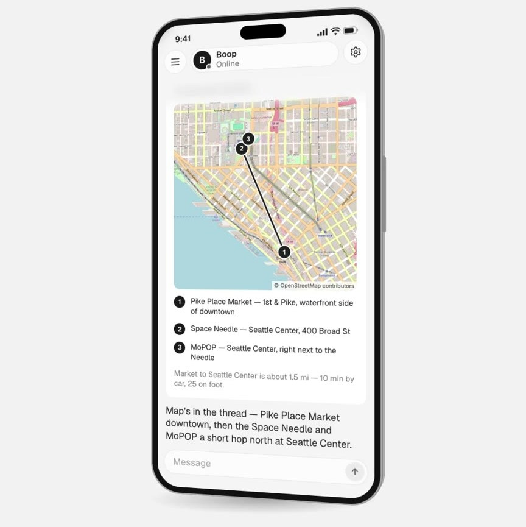
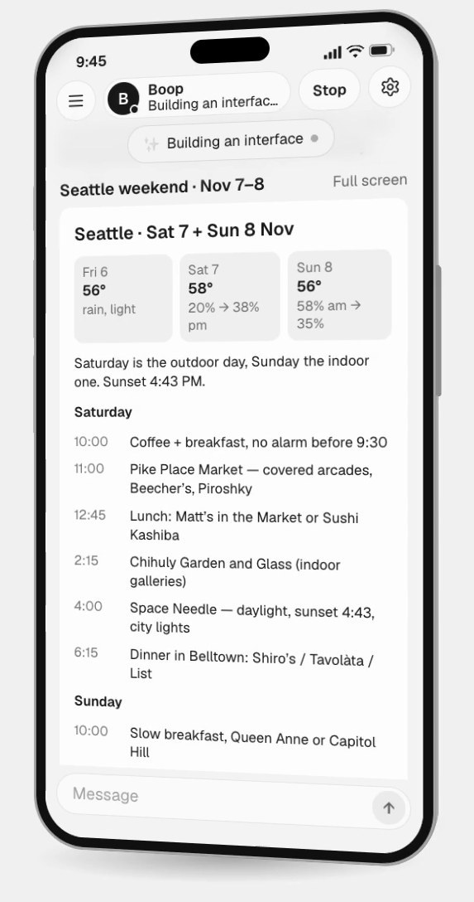

# Boop

An AI assistant on your own DeepSeek Harness: on your Mac, or on a server of your own. You talk to it from your phone, and it keeps working after you close the app. It has a shell, files, web search and a browser that keeps its logins; it comes back when something is done or needs your yes, and answers with real controls (a choice, a form, a table) instead of a wall of text.

On your Mac it shows a code. Open Boop on your phone, tap Scan the code, and you're connected. No account.

The phone app: **Android**, [download boop.apk](https://github.com/jt-wang/boop/releases/latest/download/boop.apk); **iPhone**, no download yet: build it yourself with Xcode ([docs/ios.md](docs/ios.md)); so far it has run on the simulator only.

Run it on your computer:

- **Mac**: [download Boop.dmg](https://github.com/jt-wang/boop/releases/latest/download/Boop.dmg). Nothing else to install.
- **In a terminal**: `curl -fsSL https://raw.githubusercontent.com/jt-wang/boop/main/install.sh | sh`, then `cd ~/boop && DEEPSEEK_API_KEY=sk-… npm start` and scan the code it prints from Boop on your phone.
- **With your AI agent**: point it at [SETUP.md](SETUP.md).
- **Build it yourself**, or run it on your own server with Docker or Fly.io: [docs/BUILD.md](docs/BUILD.md).

Fully open source (MIT). Change anything you like. By Jingtao Wang, [@thejingtao](https://x.com/thejingtao).

<p align="center">
  
  
</p>

## Try it

### The phone app

- **Android**: download [boop.apk](https://github.com/jt-wang/boop/releases/latest/download/boop.apk) on the phone and open it to install.
- **iPhone**: there is no download yet. Build the app from `ios/` with Xcode ([docs/ios.md](docs/ios.md)). It has run on the simulator; a physical iPhone is not tested yet.

### On your Mac

1. [Download Boop.dmg](https://github.com/jt-wang/boop/releases/latest/download/Boop.dmg), open it and drag the app to Applications.
2. Open Boop. It is not notarized yet, so macOS stops it the first time: open System Settings → Privacy & Security and choose Open Anyway. The window says when your assistant is running and shows a code.
3. Open Boop on your phone and tap Scan the code. Name your assistant, say hi. You pair once; the phone then reaches the Mac through [TailPocket](https://github.com/jt-wang/tailpocket) ([docs/connection.md](docs/connection.md)).

The app keeps the assistant running while its window is open, brings it back if it stops, and remembers everything between launches. Node and the assistant's files are inside the app; nothing else to install.

### In a terminal

```sh
curl -fsSL https://raw.githubusercontent.com/jt-wang/boop/main/install.sh | sh
cd ~/boop
DEEPSEEK_API_KEY=sk-… npm start
```

The terminal prints a QR code. Scan it from the phone app.

To use a phone's browser instead of the app (any phone, same Wi-Fi, plain HTTP): start with `npm start -- --host 0.0.0.0`, open the link it prints, pair. Add it to the home screen for a full-screen app.

How each route works and who can read the traffic: [docs/connection.md](docs/connection.md).

Any OpenAI-compatible model works too:

```sh
npm start -- --model myproxy/deepseek-v4-flash --base-url https://example.com/v1 --api-key-env MY_KEY
```

Keep it running after logout: `scripts/install-service.sh` (launchd on macOS, systemd on Linux).

### Let your AI agent install it

Point it at [SETUP.md](SETUP.md).

### Build it yourself

To change the code, run it on your own server, or get the iPhone app: [docs/BUILD.md](docs/BUILD.md).

## What it does

| | |
|---|---|
| One assistant, one thread | Side chats for separate projects. No bot roster to manage. |
| Speaks first | After you name it, it introduces itself and asks what to call you. |
| Status line | One line under its name says what it is doing right now. Nothing else performs "thinking". |
| Approvals | Anything hard to undo stops and asks: allow once, allow for this task, always allow, decline. The card says exactly what will happen. |
| Cards | When the answer is a choice, a form, a table or a plan, it shows one — native controls, one tap to answer — instead of prose. |
| Memory with a shape | About you, things it is tracking, decisions, people. Forget one line with a tap. Export and import as one file. |
| Reminders and checks | "Remind me Thursday at 9" — it confirms the time, and the reminder arrives as a message plus a notification, with the app closed. |
| Goals | A goal becomes a plan it follows up on; progress shows on the Discover tab. |
| Discover | What it is tracking for you: needs you, goals and waits, ideas for you (new each day, or tap New ideas), recently done. |
| Its own computer | A sandboxed shell, files, web search and a real browser with persistent logins — on your Mac or on a VPS. |
| Library | Everything it wrote or produced, viewable from the phone. |
| Connectors | Add any MCP server (GitHub, Notion, Google Calendar, your own); keys stay in environment variables on the computer. |
| Notifications that earn their place | Only when it needs you, finished something, a reminder fired, or you asked it to watch something. |
| Stop | Long-press the status line. |
| Usage | Tokens per day and per thread. |

Measured on a Mac with DeepSeek V4.1 Flash: first reply 5 s after sending; a reminder asked for in chat fires, is answered, and pushes in 78 s; "remember that I take oat milk" lands in memory in 11 s; opening a web page through its browser and reading it back in 28 s.

## How it works

Three parts, each replaceable:

| Part | Role |
|---|---|
| DeepSeek Harness (`dsh web`, loopback only) | the agent loop, sessions, sandbox, tools, compaction |
| `bot` (`src/`) | pairing, push, reminders, memory, goals, ideas, library, connectors — all as separate modules; the assistant reaches them as MCP tools |
| the app (`mobile/`, Native Shell TSX; `app/`, the web client) | talks only to `bot`'s HTTP/WebSocket API |

`bot` sees the harness through one interface (`src/harness.ts`): create and list sessions, send a message, follow a session, answer an approval, stop. Clients get `bot`'s own thread protocol (`/threads`, `/events`). Swapping the harness means implementing that interface and a frame translator (`src/fold.ts`); the app does not change. The DSH wire protocol is still proxied at `/api/*` for clients that speak it.

Files live in `~/.deepseek-bot/`:

```
config.json           model, port, assistant name, notifications
workspace/            the assistant's working directory: SOUL.md, USER.md, MEMORY.md and what it makes
goals.json  schedules.json  ideas.json  activity.json  connectors.json
connector-secrets.json  tokens of the services you connected (0600; docs/connectors.md)
dsh/                  DeepSeek Harness home (sessions, profile patch written on every start)
devices.json          paired phones (hashed tokens)   push.json  Web Push keys and subscriptions
browser-broker/       the assistant's browser when the bot runs in the image (uid 1001, profile and logins)
browser-profile/      the assistant's browser on a laptop (stdio mode)
```

## License

MIT
